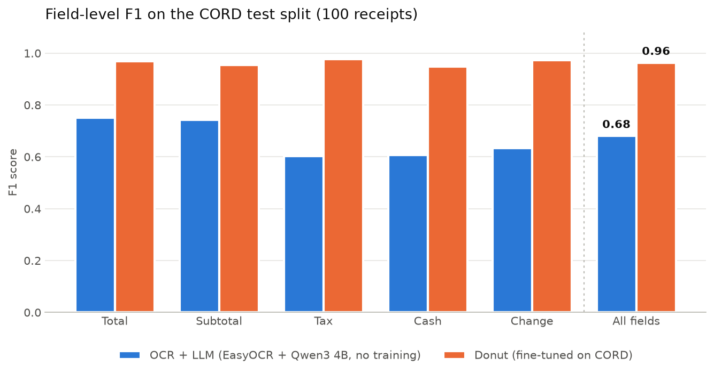

# Receipt Extraction Benchmark: OCR + LLM vs. Donut
 
How close does a **training-free OCR + LLM pipeline** get to a **specialised end-to-end document model** when extracting payment amounts from receipt photos?
 
This project compares both approaches on the public CORD receipt dataset, with the same data, the same metric and the same hardware (a laptop GPU with 4 GB VRAM).
 

 
## TL;DR
 
| Method | Training on CORD | Precision | Recall | F1 | Fully correct receipts | Seconds / receipt |
|---|---|---|---|---|---|---|
| OCR + LLM (EasyOCR + Qwen3 4B) | none | 0.683 | 0.679 | 0.681 | 35% | 9.4 |
| Donut (fine-tuned on CORD) | 800 labelled receipts | **0.955** | **0.972** | **0.963** | **85%** | **3.4** |
 
*CORD test split, 100 receipts, field-level micro scores over 5 summary fields.*
 
- On its home turf, the fine-tuned specialist (Donut) is clearly better **and** about 2.7× faster.
- The OCR + LLM pipeline needs **no labelled data at all** – it works from a prompt. Its weak point is not the LLM's understanding but the **OCR step**: values that are misread or lost there cannot be recovered later.
- The OCR + LLM pipeline scores almost identically on validation (0.686) and test (0.681), so the design decisions made during development generalise.
## Motivation
 
There are two common ways to turn a document image into structured data:
 
1. **Pipeline:** run OCR to get text, then let a language model extract the fields. Flexible – a new document type only needs a new prompt.
2. **End-to-end:** a single model reads the image and directly outputs the fields. Usually more accurate, but it has to be trained on labelled examples of exactly that document type.
This project measures the gap between the two on a realistic task: reading total, subtotal, tax, cash and change from phone photos of receipts.
 
## Dataset
 
[CORD v2](https://huggingface.co/datasets/naver-clova-ix/cord-v2) contains 1,000 photos of Indonesian shop receipts with structured labels (800 train / 100 validation / 100 test).
 
**Evaluated fields.** I evaluate five summary fields that appear often enough to give meaningful scores (coverage in the training split):
 
| Field | Meaning | Coverage |
|---|---|---|
| `total_price` | final amount to pay | 97% |
| `subtotal_price` | amount before tax/service | 66% |
| `cashprice` | amount paid in cash | 65% |
| `changeprice` | change returned | 62% |
| `tax_price` | tax amount | 44% |
 
Line items (names, quantities, prices) are not part of this comparison.
 
**Data quirks found during exploration** (`notebooks/01_explore_cord.ipynb`):
- Prices use Indonesian formatting (comma or dot as thousands separator, e.g. `75,000`), and formatting varies between receipts.
- `menu` is a list when a receipt has several items but a single object when it has one item – labels are normalised before use.
- Even the ground truth contains noise, e.g. a change value labelled as `":9,000"`.
- Merchant name and date are not labelled in CORD.
## Methods
 
### A: OCR + LLM (no training)
 
1. **OCR** – [EasyOCR](https://github.com/JaidedAI/EasyOCR) detects and reads text boxes. Default settings were kept: tuning the detection parameters improved OCR coverage by only 1.7 pp at 2.2× runtime.
2. **Line grouping** – text boxes are grouped into lines by their vertical position (relative to the box height) and sorted left to right, so that a label and its amount end up on the same line.
3. **LLM extraction** – [Qwen3 4B](https://ollama.com/library/qwen3) runs locally via [Ollama](https://ollama.com) (4-bit quantised, reasoning disabled, temperature 0). A JSON schema enforces the output format (*structured outputs*): every field is required and must be an integer or `null`. The prompt explains the number format, common OCR confusions (`O`→`0`, `l`→`1`) and gives one invented example (few-shot).
4. **Grounding** – if a predicted amount does not appear in the OCR text but exactly one OCR number differs by a single digit (Levenshtein distance 1, never shorter), the OCR number is used instead. The LLM decides *which* number belongs to a field; the OCR text supplies the exact digits.
### B: Donut (fine-tuned)
 
[Donut](https://arxiv.org/abs/2111.15664) is an OCR-free transformer: a Swin encoder reads the image and a BART-style decoder generates the fields as a tag sequence. I use the publicly released checkpoint [`naver-clova-ix/donut-base-finetuned-cord-v2`](https://huggingface.co/naver-clova-ix/donut-base-finetuned-cord-v2), which the authors fine-tuned on the CORD training split. It is used **as released**, without any tuning.
 
## Evaluation
 
- **Normalisation:** predictions and labels are reduced to digits before comparison (`"45,500"` → `45500`), so formatting differences do not count as errors.
- **Per field:** a correct value is a true positive; a value for a field that is not on the receipt, or a wrong value, is a false positive; a missing or wrong value for a field that is on the receipt is a false negative. A wrong value therefore counts as both FP and FN.
- **Scores:** micro-averaged precision, recall and F1 over all fields, plus the share of **fully correct receipts** (all five fields right).
- **Protocol:** all development decisions were made on the validation split. Both methods were frozen before running them on the test split once.
Note: the Donut paper reports lower scores on CORD because it evaluates *all* fields including line items. The five summary fields used here are the easier part of the task, so the numbers are not directly comparable to the paper.
 
## Results
 
| | OCR + LLM (validation) | OCR + LLM (test) | Donut (validation) | Donut (test) |
|---|---|---|---|---|
| F1 | 0.686 | 0.681 | 0.987 | 0.963 |
| Fully correct | 30% | 35% | 95% | 85% |
 
Per-field F1 on the test split:
 
| Field | OCR + LLM | Donut |
|---|---|---|
| Total | 0.750 | 0.969 |
| Subtotal | 0.742 | 0.954 |
| Tax | 0.602 | 0.976 |
| Cash | 0.607 | 0.947 |
| Change | 0.635 | 0.974 |
 
Donut drops slightly from validation to test, which is consistent with the checkpoint having been selected on the validation split – the test split is the fair comparison.
 
## Developing the OCR + LLM pipeline
 
All versions are logged in [`results/EXPERIMENTS.md`](results/EXPERIMENTS.md). Validation F1 went from 0.642 to 0.686:
 
| Version | Change | Val F1 |
|---|---|---|
| v1 | EasyOCR + Qwen3 4B, integer schema, few-shot example | 0.642 |
| v2 | all schema fields required | 0.657 |
| v3 | grounding: snap amounts to OCR numbers within edit distance 1 | 0.670 |
| v4 | grounding never snaps to a shorter number | **0.686** |
 
Two findings from this process:
 
- **A subtle schema bug.** Fields later in the schema were missed far more often (change: 24 misses, total: 1). Because the fields had default values, the schema allowed the model to close the JSON early and silently skip them. Making all fields required fixed this.
- **Grounding needs a guard.** In v3, snapping fixed 13 values but broke 9 – and all 6 cases where it shortened a number were harmful: the OCR had dropped a misread zero, while the LLM had correctly restored it. v4 forbids shortening (16 fixed / 7 broken). Further rules were not added to avoid overfitting to 100 validation receipts.
## Error analysis
 
**How much can the LLM recover at most?** For each labelled value I checked whether it appears in the OCR text (`notebooks/02_ocr.ipynb`):
 
| | Coverage |
|---|---|
| Value appears exactly in the OCR text | 71.5% |
| Value appears after correcting typical confusions (`O`→`0`, `l`→`1`, …) | 82.6% |
 
So roughly one in six values is already lost before the LLM sees the text.
 
**Where do the errors come from?** Error categories for v2 on the validation split (145 wrong field predictions):
 
| Category | Count | Cause |
|---|---|---|
| LLM picked a wrong value | 44 | includes line-grouping errors on tilted photos |
| Value missing from OCR text | 42 | OCR |
| Zero values (e.g. change = 0) | 22 | mostly OCR: a lone `0` is often not detected, or merged into a word (`CHANGED`) |
| LLM returned `null` although the value is present | 24 | LLM |
| LLM invented a value | 13 | LLM |
 
Typical OCR failures: zeros read as letters (`50,ooo`, `9,CCo`, even `coo`), thin single digits not detected, and on tilted photos the amounts are paired with the label of the neighbouring line. Donut has none of these intermediate steps – it reads the receipt that was misaligned for the pipeline without a single error.
 
## Discussion
 
On a fixed document type with labelled training data, the fine-tuned end-to-end model is the better choice: more accurate, faster, and simpler to run. The OCR + LLM pipeline's main limitation is its first stage – most of its errors are already present in the OCR text, and a small 4B model cannot reliably repair them or copy long digit sequences. The grounding step shows how both parts can complement each other: the LLM chooses the field, the OCR supplies the digits.
 
The pipeline's advantage – no labelled data, adaptable via a prompt – is not visible in this benchmark, because Donut was trained on exactly this receipt format. A fair next step is to test both methods on documents Donut has never seen.
 
## Limitations
 
- 100 test receipts: differences of a few percentage points are within noise.
- Only five summary fields; line items are not evaluated.
- One OCR engine, one LLM, one prompt – a stronger OCR or a larger model would shift the pipeline's results.
- Hardware: on 4 GB VRAM about 30% of the LLM runs on the CPU, which inflates the pipeline's runtime.
- Both the dataset and Donut's training data are Indonesian receipts; results may differ for other countries and formats.
## What I would try next
 
- **Out-of-distribution test:** run both methods on German receipts, which Donut has never seen.
- **Better OCR** (e.g. PaddleOCR) to raise the pipeline's upper bound.
- **Deskewing / robust line grouping** for tilted photos.
- **Real few-shot examples** from the training split instead of an invented one.
- **A small vision-language model** that reads the image directly without OCR and without task-specific training.
- **Line items**, evaluated with a list-matching metric.
## Reproduce
 
Requirements: Python 3.12, an NVIDIA GPU (tested on an RTX 3050 Laptop, 4 GB), [Ollama](https://ollama.com).
 
```bash
git clone https://github.com/abd-ahmad/receipt-extraction-benchmark.git
cd receipt-extraction-benchmark
python -m venv .venv
.venv\Scripts\activate            # Windows (Linux/macOS: source .venv/bin/activate)
pip install -r requirements.txt
ollama pull qwen3:4b
 
# Approach A: OCR + LLM
python -m src.run_ocr --split test
python -m src.run_llm --split test --name ocr_llm_v2
python -m src.postprocess results/predictions/ocr_llm_v2_test.json --name ocr_llm_v4
python -m src.evaluate results/predictions/ocr_llm_v4_test.json
 
# Approach B: Donut
python -m src.run_donut --split test
python -m src.evaluate results/predictions/donut_test.json
```
 
The dataset and models are downloaded automatically into `data/` (not part of the repository). OCR outputs and predictions are included in `results/`, so the evaluation can be reproduced without a GPU.
 
## Project structure
 
```
├── notebooks/
│   ├── 01_explore_cord.ipynb      # dataset exploration, field selection
│   ├── 02_ocr.ipynb               # OCR, line grouping, OCR coverage
│   ├── 03_llm_extraction.ipynb    # LLM extraction, error analysis
│   ├── 04_donut.ipynb             # Donut inference
│   └── 05_results.ipynb           # final comparison figure
├── src/
│   ├── utils.py                   # label parsing, field access, normalisation
│   ├── ocr.py                     # EasyOCR wrapper, line grouping
│   ├── run_ocr.py                 # batch OCR
│   ├── llm_extract.py             # prompt, schema, Ollama call
│   ├── run_llm.py                 # batch LLM extraction
│   ├── postprocess.py             # grounding of predicted amounts
│   ├── donut.py                   # Donut inference
│   ├── run_donut.py               # batch Donut inference
│   └── evaluate.py                # precision / recall / F1
├── results/
│   ├── ocr/                       # saved OCR outputs
│   ├── predictions/               # predictions of every version
│   ├── metrics/                   # evaluation tables
│   ├── figures/                   # figures for this README
│   └── EXPERIMENTS.md             # experiment log
└── requirements.txt
```
 
## References
 
- Park et al. (2019): *CORD: A Consolidated Receipt Dataset for Post-OCR Parsing.* Document Intelligence Workshop at NeurIPS.
- Kim et al. (2022): *OCR-free Document Understanding Transformer.* ECCV. [arXiv:2111.15664](https://arxiv.org/abs/2111.15664)
- [EasyOCR](https://github.com/JaidedAI/EasyOCR), [Qwen3](https://ollama.com/library/qwen3), [Ollama](https://ollama.com), [Hugging Face Transformers](https://huggingface.co/docs/transformers)
## License
 
MIT